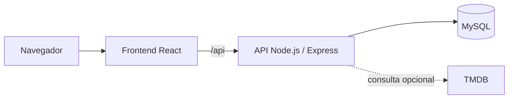

# Film Catalog

## Introdução

O Film Catalog permite descobrir filmes, consultar detalhes, guardar favoritos e organizar uma lista pessoal do que assistir. O modo de demonstração reúne **40 filmes reais** em cinco páginas, com sinopses escritas para o projeto, e funciona sem chave de API. Para buscar além dessa seleção, é possível configurar uma chave da API v3 do TMDB.

É uma aplicação local, sem contas ou autenticação. Favoritos e lista pessoal são salvos no MySQL. Pôsteres, imagens de fundo e trailers dependem de internet, inclusive no modo de demonstração.

## Tecnologias e arquitetura

- **Frontend:** React e Vite.
- **Backend:** Node.js e Express; consulta a seleção local ou o TMDB.
- **Dados:** MySQL, com migrações executadas antes da API no Docker Compose.



O frontend organiza telas e componentes em `Frontend/src`. No backend, `routes` recebe as requisições, `services` aplica as regras de negócio, `repositories` acessa o banco e `db/migrations` mantém o esquema. A chave do TMDB fica somente no backend.

## Como executar

### Com Docker

1. Instale Docker com Compose e abra um terminal na raiz do repositório.
2. Copie `.env.example` para `.env` (`Copy-Item .env.example .env` no PowerShell ou `cp .env.example .env` no Bash). Preencha **`MYSQL_PASSWORD` e `MYSQL_ROOT_PASSWORD`** no arquivo copiado; o modo de demonstração já está selecionado.
3. Inicie os serviços com `docker compose up --build -d --wait` e abra [http://127.0.0.1:5174](http://127.0.0.1:5174), ou a porta configurada em `WEB_PORT`.

Para conferir os serviços, execute `docker compose ps`; em caso de falha, consulte `docker compose logs db migrate backend frontend`.

O padrão é `CATALOG_SOURCE=demo`. Para usar o TMDB ao vivo, defina `CATALOG_SOURCE=tmdb` e `TMDB_API_KEY` no `.env` e execute novamente `docker compose up --build -d --wait`. O frontend é o único serviço publicado no computador, em `127.0.0.1`.

`docker compose down` para os serviços e preserva os dados no volume `mysql_data`. **`docker compose down --volumes` apaga esse volume.** As senhas do MySQL são aplicadas quando o volume é criado; alterá-las no `.env` depois disso não muda as contas já existentes. Veja [backup e restauração](docs/backup.md) antes de remover o volume ou substituir dados.

### Sem Docker

Instale **Node.js 22.12+**, **MySQL 8.0.16+** e o cliente de linha de comando `mysql`. Na raiz do repositório, crie o banco `movie_catalog` com uma conta que tenha permissão para isso:

```sh
mysql -u root -p -e "CREATE DATABASE IF NOT EXISTS movie_catalog;"
```

Copie `Backend/.env.example` para `Backend/.env` (`Copy-Item Backend/.env.example Backend/.env` no PowerShell ou `cp Backend/.env.example Backend/.env` no Bash). Configure `DB_USER` e `DB_PASSWORD` para a sua instalação do MySQL. Para usar o TMDB ao vivo sem Docker, defina também `CATALOG_SOURCE=tmdb` e `TMDB_API_KEY` nesse arquivo.

Em um terminal na raiz do repositório, inicie a API:

```sh
cd Backend
npm ci
npm run db:migrate
npm start
```

Em outro terminal na raiz do repositório, inicie a interface:

```sh
cd Frontend
npm ci
npm run dev
```

Abra [http://localhost:5173](http://localhost:5173). O Vite encaminha `/api` para a API local na porta `3000`.

### Testes

Em `Backend`, execute `npm test`. Em `Frontend`, execute `npm test`, `npm run lint` e `npm run build`. O teste de integração do backend (`npm run test:integration`) usa um MySQL de teste configurado por `DB_TEST_HOST`, `DB_TEST_PORT`, `DB_TEST_USER` e `DB_TEST_PASSWORD`; o usuário precisa poder criar e remover bancos de teste.

## O que experimentar

1. Explore os 40 filmes, busque por título e refine por gênero ou ano.
2. Abra a ficha de um filme e salve-o como favorito.
3. Adicione filmes à lista pessoal e registre estado, data, nota e comentário.
